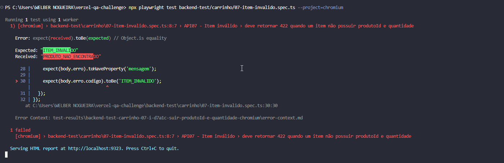
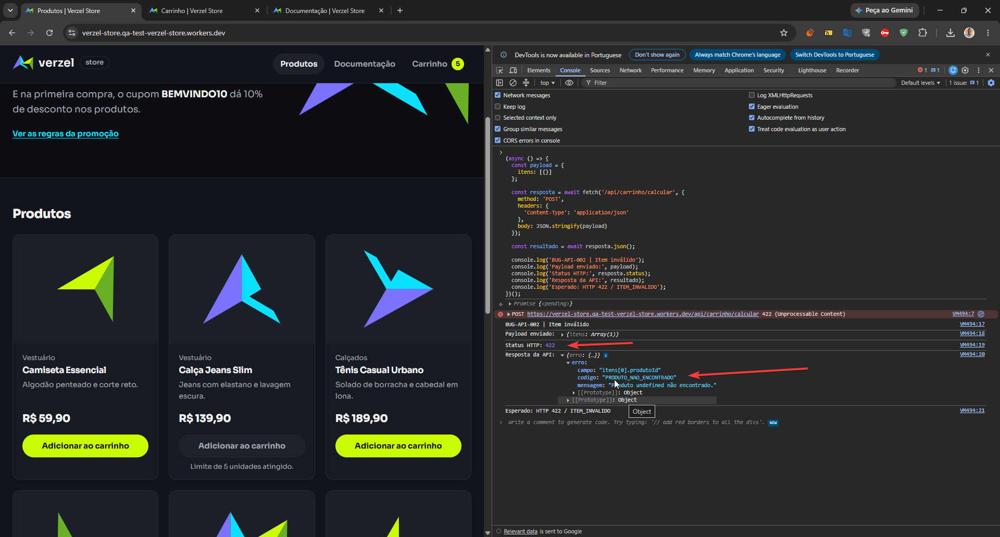

# BUG-API-002 — Item inválido retorna código de erro incorreto

## Identificação

| Campo | Valor |
|---|---|
| Cenário | CT-15.1 |
| Módulo | API de carrinho |
| Método e endpoint | `POST /api/carrinho/calcular` |
| Prioridade | Média |
| Severidade | Média |
| Status | Aberto |

## Descrição

Quando `itens` contém um objeto sem `produtoId` e sem `quantidade`, a API responde com HTTP `422`, porém usa o código `PRODUTO_NAO_ENCONTRADO`. Para essa estrutura malformada, o contrato documentado prevê `ITEM_INVALIDO`.

## Pré-condições

- Ambiente de QA disponível.
- Endpoint de cálculo acessível.

## Passos para reproduzir

1. Abra a loja de QA e o console do navegador.
2. Execute a requisição abaixo.
3. Confira o status HTTP e `erro.codigo` no corpo da resposta.

```js
fetch('/api/carrinho/calcular', {
  method: 'POST',
  headers: { 'Content-Type': 'application/json' },
  body: JSON.stringify({ itens: [{}] })
}).then(async response => ({
  status: response.status,
  body: await response.json()
})).then(console.log);
```

## Resultado esperado

- HTTP `422`.
- Código `ITEM_INVALIDO`.

## Resultado observado

- HTTP `422`.
- Código `PRODUTO_NAO_ENCONTRADO`.

## Impacto

O status comunica que a requisição foi rejeitada, mas o código descreve uma causa diferente da entrada enviada. Clientes da API podem exibir uma mensagem inadequada ou tratar incorretamente o erro.

## Evidências

<figure align="center">
  
  <figcaption><strong>BUG-API-002 · Código de erro retornado para item inválido</strong></figcaption>
</figure>

<figure align="center">
  
  <figcaption><strong>CT-15.1 · Evidência complementar da resposta</strong></figcaption>
</figure>

## Automação relacionada

[`backend-test/carrinho/07-item-invalido.spec.ts`](../backend-test/carrinho/07-item-invalido.spec.ts) verifica o contrato esperado. O teste expressa a divergência conhecida e não foi executado nesta revisão.
