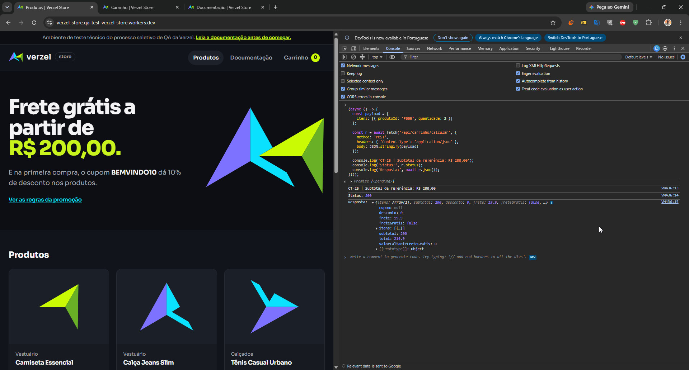
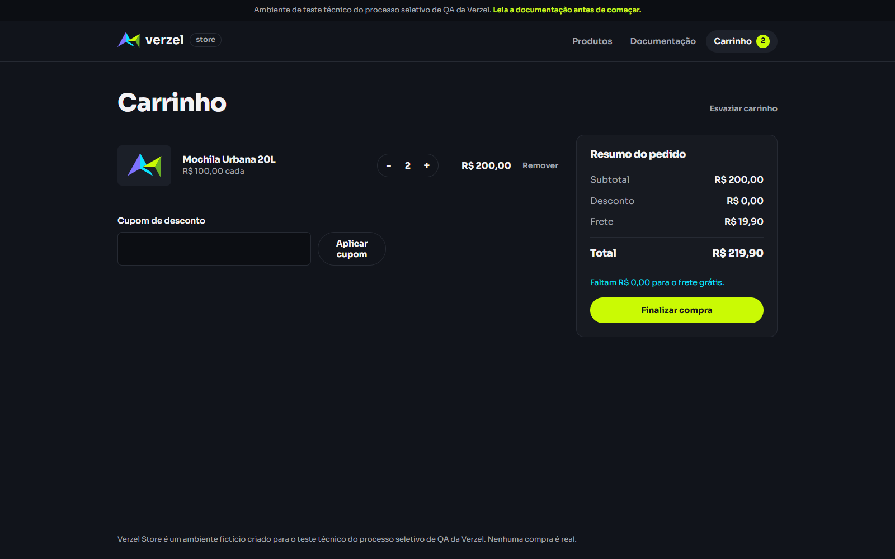

# BUG-CA06-API-001 — API cobra frete no subtotal exato de R$ 200,00

## Identificação

| Campo | Valor |
|---|---|
| Cenário | CA06 / CT-06 |
| Módulo | Cálculo de frete / API de carrinho |
| Método e endpoint | `POST /api/carrinho/calcular` |
| Prioridade | Alta |
| Severidade | Alta |
| Status | Aberto |

## Descrição

O critério CA06 determina frete grátis para subtotal maior ou igual a R$ 200,00. Com duas Mochilas Urbanas P005, o subtotal é exatamente R$ 200,00, mas a API retorna frete de R$ 19,90 e informa `freteGratis=false`. A interface apresenta a mesma cobrança.

## Pré-condições

- Ambiente de QA disponível no navegador.
- Produto P005 com preço unitário de R$ 100,00.

## Passos para reproduzir

1. Abra a loja de QA e o console do navegador.
2. Execute a requisição abaixo.
3. Confira `subtotal`, `frete`, `freteGratis`, `valorFaltanteFreteGratis` e `total`.
4. Opcionalmente, adicione duas Mochilas P005 pela interface e confira o resumo do carrinho.

```js
fetch('/api/carrinho/calcular', {
  method: 'POST',
  headers: { 'Content-Type': 'application/json' },
  body: JSON.stringify({ itens: [{ produtoId: 'P005', quantidade: 2 }] })
}).then(async response => ({
  status: response.status,
  body: await response.json()
})).then(console.log);
```

## Resultado esperado

- HTTP `200`.
- Subtotal `200.00`.
- Frete `0.00` e `freteGratis=true`.
- Valor faltante para frete grátis `0.00`.
- Total `200.00`.

## Resultado observado

- HTTP `200`.
- Subtotal `200.00`.
- Frete `19.90` e `freteGratis=false`.
- Valor faltante `0.00`.
- Total `219.90`.

## Impacto

O carrinho cobra frete de clientes que atingem o valor mínimo documentado para frete grátis. O defeito ocorre exatamente no limite e também foi observado na interface.

## Evidências

<figure align="center">
  
  <figcaption><strong>BUG-CA06-API-001 · Captura original da resposta no limite exato</strong></figcaption>
</figure>

<figure align="center">
  
  <figcaption><strong>CT-06 · Mesmo defeito observado na interface</strong></figcaption>
</figure>

A captura original da resposta foi feita durante a exploração do CT-25 e conserva esse rótulo no console. O payload e o retorno mostram duas unidades de P005 e subtotal de R$ 200,00. A captura da chamada identificada corretamente como CT-06 está disponível em [request-response.json](../evidencias/BUG-CA06-API-001-request-response.json).

## Automação relacionada

O caso de subtotal exato em [`e2e/cupons/06-frete-gratis-a-partir-200.spec.ts`](../e2e/cupons/06-frete-gratis-a-partir-200.spec.ts) verifica a expectativa e está marcado com test.fail enquanto o defeito persistir. A suíte não foi executada nesta revisão.
