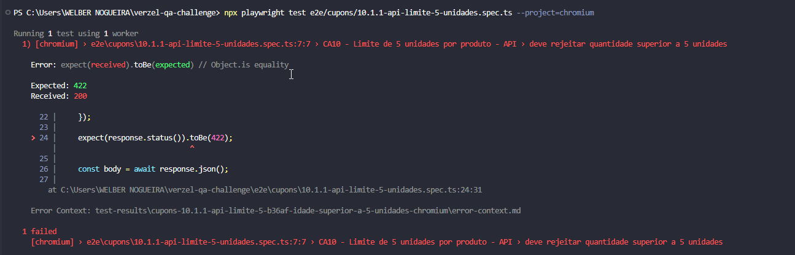
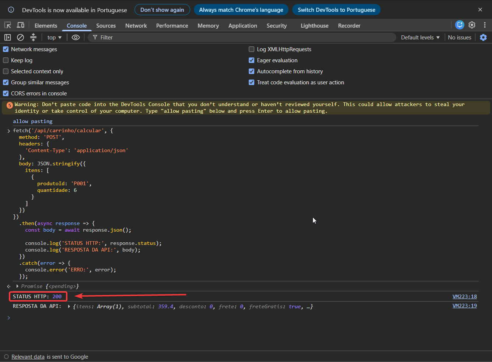
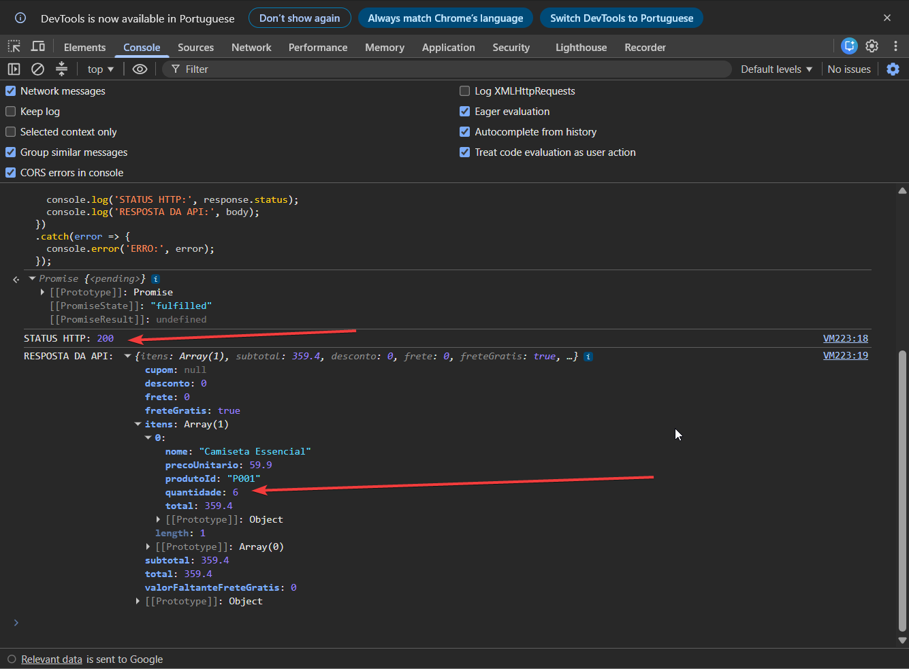
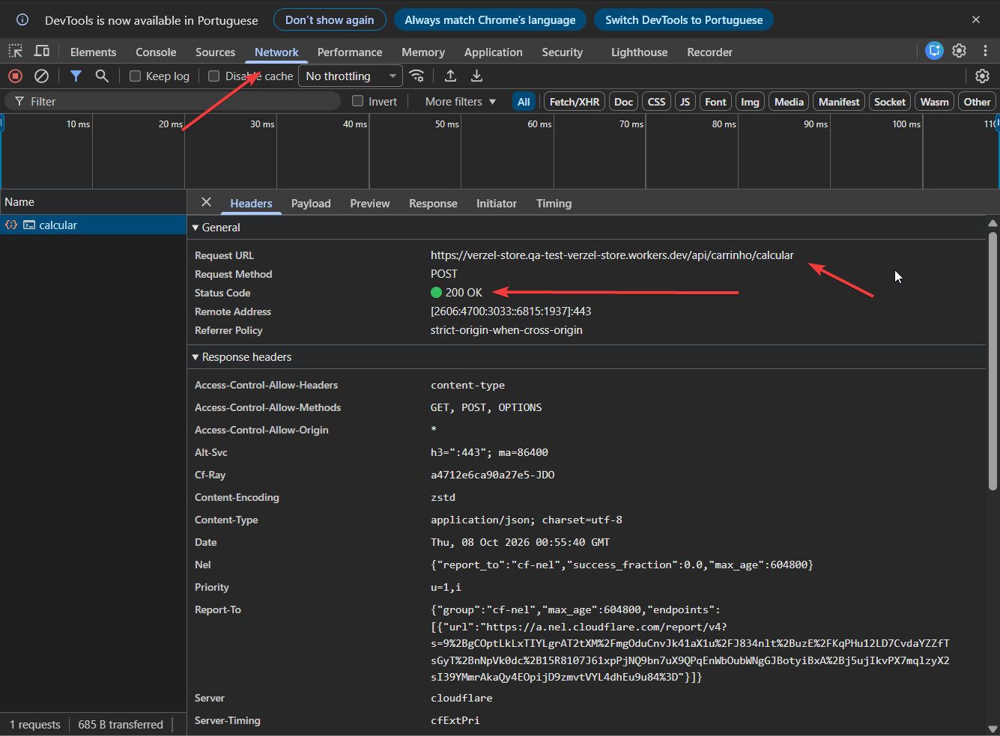

# BUG-CA10-API-001 — API aceita mais de cinco unidades por produto

## Identificação

| Campo | Valor |
|---|---|
| Cenário | CA10 / CT-11 |
| Módulo | API de carrinho |
| Método e endpoint | `POST /api/carrinho/calcular` |
| Prioridade | Alta |
| Severidade | Alta |
| Status | Aberto |

## Descrição

A regra do desafio limita cada produto a cinco unidades por pedido. A interface bloqueia a sexta unidade, mas a API aceita diretamente uma quantidade de seis e calcula o carrinho.

## Pré-condições

- Ambiente de QA disponível no navegador.
- Produto P001 existente.

## Passos para reproduzir

1. Abra a loja de QA e o console do navegador.
2. Execute a requisição abaixo.
3. Confira o status HTTP e o corpo da resposta.

```js
fetch('/api/carrinho/calcular', {
  method: 'POST',
  headers: { 'Content-Type': 'application/json' },
  body: JSON.stringify({ itens: [{ produtoId: 'P001', quantidade: 6 }] })
}).then(async response => ({
  status: response.status,
  body: await response.json()
})).then(console.log);
```

## Resultado esperado

- HTTP `422`.
- Código `QUANTIDADE_MAXIMA_EXCEDIDA`.
- Campo `itens[0].quantidade`.
- Mensagem que informe o limite de cinco unidades.

## Resultado observado

A API retorna HTTP `200` e calcula o carrinho com seis unidades de P001, sem retornar o erro de limite esperado.

## Impacto

Uma requisição direta pode criar um carrinho que viola a regra de quantidade, mesmo que a interface impeça essa operação. A validação do limite precisa existir também na API.

## Evidências

<figure align="center">
  
  <figcaption><strong>BUG-CA10-API-001 · Divergência entre status esperado e recebido</strong></figcaption>
</figure>

<figure align="center">
  
  <figcaption><strong>BUG-CA10-API-001 · Requisição reproduzida no console</strong></figcaption>
</figure>

<figure align="center">
  
  <figcaption><strong>BUG-CA10-API-001 · Resposta calculada com quantidade acima do limite</strong></figcaption>
</figure>

<figure align="center">
  
  <figcaption><strong>BUG-CA10-API-001 · Status HTTP 200 no painel de rede</strong></figcaption>
</figure>

## Automação relacionada

- [`backend-test/carrinho/11-quantidade-maxima.spec.ts`](../backend-test/carrinho/11-quantidade-maxima.spec.ts)
- [`e2e/cupons/10.1.1-api-limite-5-unidades.spec.ts`](../e2e/cupons/10.1.1-api-limite-5-unidades.spec.ts)

Os dois testes expressam o contrato esperado e estão marcados como falha esperada enquanto o defeito persistir. A suíte não foi executada nesta revisão.
